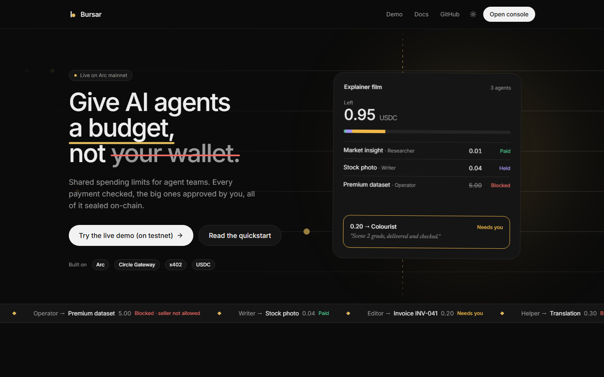

# Dami904 · Portfolio

Personal site of **Dami (Dami904)**, a backend-first product engineer building AI agents, payment products and private on-chain systems.



## What's on it

- **Selected work**: Tender, Bursar, Fides and Umbra as large case-study cards, plus a grid with Nema, Kalyptra, Pii, Currant and a featured ShieldPass card. Each shows real screenshots of the live product.
- **Recognition**: Arc Microgrant (Pii), Flare Summer Signal winner (Umbra), Canteen Arc mainnet bounty winner (Bursar).
- **Open source**: merged contributions to [KeeperHub](https://github.com/KeeperHub/keeperhub).
- **More projects**: a list with a live preview of each app on hover.

## Stack

- [Next.js 15](https://nextjs.org) (App Router) and TypeScript
- [Tailwind CSS v4](https://tailwindcss.com)
- [Framer Motion](https://motion.dev) for scroll reveals, count-ups and the hover preview
- `next/font` with Inter and Inter Tight

## Run it

```bash
npm install
npm run dev     # http://localhost:3000
npm run build   # production build
```

## Editing content

All copy, numbers, projects and links live in [`src/content/site.ts`](src/content/site.ts). Screenshots are in `public/shots` (cards) and `public/previews` (hover previews).

## Contact

- GitHub: [@Dami904](https://github.com/Dami904)
- X: [@dami904_](https://x.com/dami904_)
- LinkedIn: [Joshua Kolawole](https://www.linkedin.com/in/joshua-kolawole7725)
